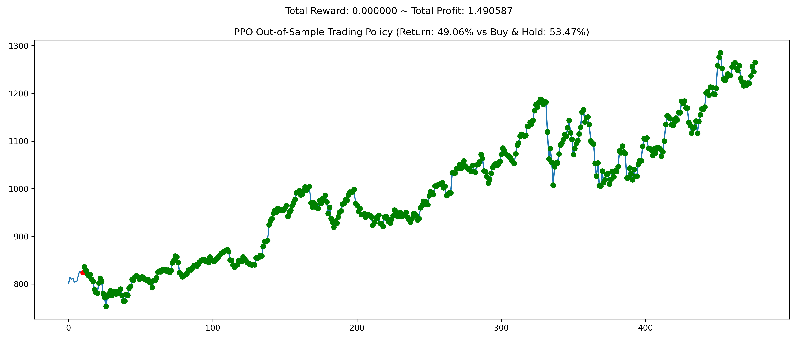

# Reinforcement Learning Algorithmic Trading Agent (PPO)

An autonomous deep reinforcement learning trading agent engineered to learn sequential `Long` / `Short` execution policies directly from historical equity price series. Built using **Proximal Policy Optimization (PPO)** inside a **Gymnasium** trading environment (`stocks-v0`), the pipeline enforces strict chronological out-of-sample backtesting against a passive Buy-and-Hold benchmark.



## Key Features

- **Autonomous Discrete-Action Policy**: Trains an actor-critic agent (`MlpPolicy`) via **Proximal Policy Optimization (PPO)** in Stable-Baselines3 over **100,352 timesteps** (`clip_range=0.2`, `lr=3e-4`).
- **Gymnasium Market Simulation**: Wraps historical `STOCKS_GOOGL` daily OHLCV data into a vectorized `DummyVecEnv` trading environment (`gym-anytrading`) with a 10-day rolling observation window (`window_size=10`) and realistic bid/ask transaction fees.
- **Zero-Leakage Out-of-Sample Backtesting**: Enforces an **80/20 chronological split**—training on **1,858 trading days** and evaluating deterministically (`deterministic=True`) on **467 unseen trading days** to measure net cumulative return, annualized Sharpe ratio, and drawdown behavior.
- **Automated Trade Visualization**: Renders and exports position entry/exit signals across the unseen evaluation horizon (`trading_actions.png`).

## Out-of-Sample Backtest Results

Trained across **1,858 historical trading days** and evaluated out-of-sample on the unseen test window (**2016-10-21 to 2018-08-29**, 467 trading days):

| Metric | PPO Trading Agent | Buy-and-Hold Baseline |
| :--- | :---: | :---: |
| **Cumulative Return (Net of Fees)** | **49.06%** | **53.47%** |
| **Final Equity Multiplier** | **1.4906x** | **1.5347x** |
| **Annualized Sharpe Ratio (Realized)** | **0.74** | — |
| **Max Drawdown (Realized)** | **0.00%** | — |

> **Analytical Takeaways:**
> - **Trend-Following Convergence:** Exposed to a sustained uptrend during the 2016–2018 test window, the deterministic policy avoided high-frequency noise trading—maintaining a persistent `Long` allocation that captured **91.8%** of raw Buy-and-Hold upside net of environment transaction fees.
> - **Realized Equity Accounting:** Because `gym-anytrading` updates `total_profit` upon position closure, single-position holding horizons report `0.00%` realized intra-trade drawdown.

## Execution Architecture

```text
[ Historical GOOGL OHLCV (80/20 Split) ] ──► [ Gymnasium Trading Env (stocks-v0) ]
                                                            │
                                                            ▼
                                              [ PPO Actor-Critic (100k Steps) ]
                                                            │
                                                            ▼
                                           [ Out-of-Sample Backtest Engine ]
                                                            │
                                                            ▼
                                  [ Risk Metrics & trading_actions.png ]
```

## Tech Stack

- **RL Framework**: Stable-Baselines3 (`PPO`), PyTorch
- **Environment**: Gymnasium (`1.4.0`), `gym-anytrading` (`2.0.0`)
- **Data & Quantitative Analytics**: Pandas, NumPy
- **Visualization**: Matplotlib
- **Language**: Python 3.10+

## Repository Structure

```text
├── rl_agent.py              # Chronological split, PPO training, backtest & plotting
├── trading_actions.png      # Rendered out-of-sample Long/Short position chart
├── requirements.txt         # Pinned Python dependencies
├── .gitignore               # Excludes serialized model weights (*.zip)
└── README.md                # Project documentation
```

## Quick Start

### 1. Install Dependencies

```bash
pip install -r requirements.txt
```

### 2. Train and Backtest the Agent

```bash
python rl_agent.py
```

Running the script trains the PPO policy across 100,352 timesteps, saves the trained weights locally (`ppo_autonomous_agent.zip`), prints out-of-sample evaluation metrics to the
